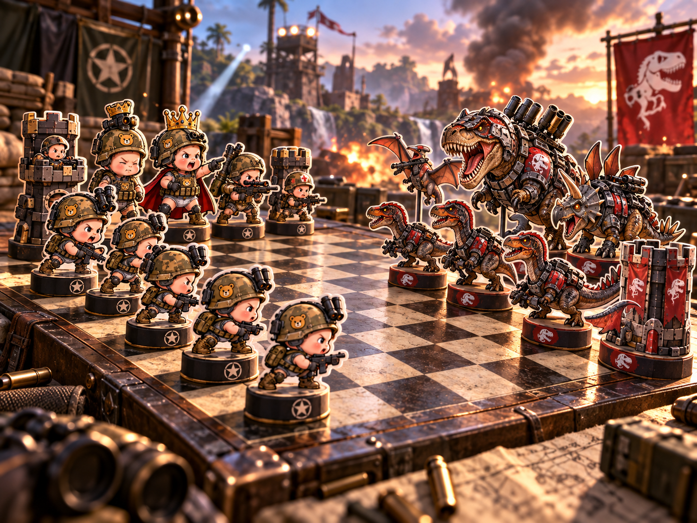

# BattleCore

Baby Army vs Armored Dinosaurs: a 3D chess game where every capture is a fight.

A giant baby and a baby dinosaur dump their toys onto a war-table chessboard. The dinos armor up, the
babies put on war paint, and both armies flatten into paper cutouts for a full game of chess. Every capture
plays an animated 3D fight scene.

- **Design doc:** [docs/DESIGN.md](docs/DESIGN.md)
- **Modes:** vs Computer · Local 2-Player · Online
- **Stack:** TypeScript · Vite · Three.js · chess.js · Stockfish WASM · Node WebSocket server

## Status

Pre-production. Next up: **M1, playable chess** with placeholder cutouts.
