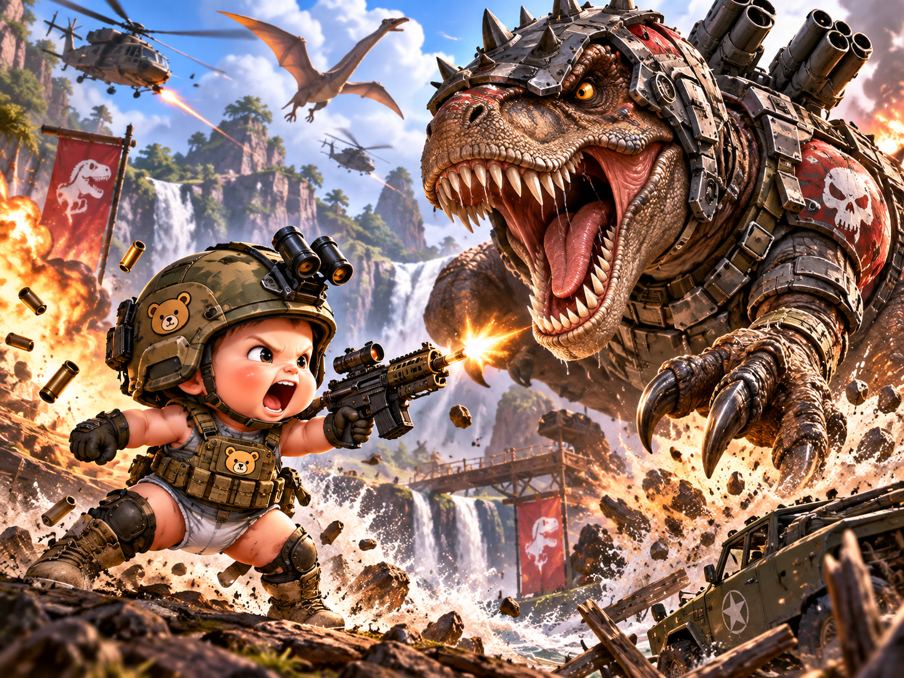

# BattleCore — Game Design Document

> **Status:** Draft v0.1 · **Last updated:** 2026-10-26
> **Genre:** Chess with cinematic combat · **Platform:** Web browser (desktop first, mobile later)


---

## 1. Pitch

A giant baby and a baby dinosaur dump their toys onto a war-table chessboard. Plastic dinosaurs come
alive in battle armor; cute babies suit up in helmets and war paint. Then both armies flatten into
paper cutouts and play a full game of chess. Every capture zooms in to a short 3D fight between
the two pieces.

**Tone:** tough military look played for laughs. Babies are fierce but adorable, dinosaurs are
scary but toy-like. Knockouts are slapstick (dizzy stars, poofs, pratfalls). No blood or gore.

**Pillars**
1. **Real chess.** Standard rules, nothing changed. A chess player should feel at home.
2. **Every capture is a show.** Fights are quick, readable, and funny.
3. **Toybox charm.** Everything reads as toys, paper cutouts, and tabletop props.

---

## 2. Factions & Pieces

| Role | Baby Army (white, moves first) | Armored Dinos (black) |
|---|---|---|
| **King** | Crowned baby commander | Armored T-Rex with back-mounted missile pods |
| **Queen** | Crowned baby with red cape | Armored Spinosaurus |
| **Rook** | Watchtower with a baby gunner inside | Red fortress tower with T-Rex banners |
| **Bishop** | Sniper baby (scope, ghillie hood) | Triceratops / stego tank with cannons |
| **Knight** | Jetpack baby | Pterodactyl gunship on a flight stand |
| **Pawn** | Baby rifleman (camo helmet, teddy-bear patch) | Raptor trooper in harness armor |

**Shared visual language**
- Baby Army: olive camo, tan gear, teddy-bear patches, **black base with white star**.
- Armored Dinos: gunmetal plates, rivets, spikes, red panels with skull/T-Rex marks,
  **red base with white T-Rex logo**.
- Promotion: a pawn that promotes plays a short "level-up" swap into the new piece.

**Intro-only characters**
- **Giant Baby:** toddler in a dinosaur-print t-shirt, huge compared to the board.
- **Baby Dino:** small, cute dinosaur wearing a t-shirt printed with babies.

---

## 3. Game Flow

```
Title ─► Mode Select ─► Intro Cinematic (skippable) ─► Match ─► Results ─► Rematch / Menu
                         │                              │
                         └──── skipped automatically    └── Capture ─► Fight Scene ─► back to Match
                               after first viewing          (on / quick / off setting)
```

### Modes
| Mode | Description |
|---|---|
| **vs Computer** | Choose side and difficulty (Easy / Medium / Hard / Max). |
| **Local 2-Player** | Two players, one screen. Camera turns to face the side to move (can be turned off). |
| **Online** | Make a private room code or join one. Quick-match comes later. |

---

## 4. Intro Cinematic (~45–60 s)

Plays when the game first loads, before the main menu. Any key or tap skips it, and the menu's
"Intro cinematic" setting chooses always / first time only (default) / never.

| # | Beat | Duration | Notes |
|---|---|---|---|
| 1 | **Establish.** Empty chessboard on a battle-scarred war table at sunset. Sandbags, banners, smoke in the distance. | 4 s | Slow push-in. |
| 2 | **Giant Baby arrives.** Toddles in; table shakes with each step. | 5 s | Camera low, looking up. |
| 3 | **The Shake.** Baby grabs the dino t-shirt and shakes it. Plastic toy dinos tumble out and bounce/clatter onto their starting squares. | 6 s | Physics-like bounce, then snap to squares. |
| 4 | **Dino Transformation.** Toys tremble → burst of smoke and sparks → swap to armored models → roar together. | 6 s | Model swap hidden behind particles. |
| 5 | **Baby Dino arrives.** Waddles up wearing the baby-print t-shirt. | 4 s | Cute music sting. |
| 6 | **Shirt off.** Pulls shirt over its head; cute babies spill out onto the board. | 5 s | |
| 7 | **Cute moment.** Babies giggle, babble, look around. | 4 s | |
| 8 | **Gets serious.** Music cuts. Babies see the dinos. Faces harden. | 3 s | Record scratch / silence. |
| 9 | **Suit-up montage.** Helmets snap on, vests buckle, goggles flip down, war paint smeared under eyes. | 8 s | Quick cuts on individual babies. |
| 10 | **Standoff.** Both armies face off across the board. | 3 s | Wide shot. |
| 11 | **Paper-ify.** A sweep of light crosses the board; every piece flattens into a 2D cutout on its base. | 4 s | Camera settles into gameplay view. |

**Implementation:** each beat is a timeline entry (camera path, animation clips, particle bursts,
audio cues) played by a small cutscene runner. "Transformations" are model swaps hidden by effects,
not real mesh morphs.

---

## 5. Match (Core Gameplay)

### Rules
- Full standard chess (FIDE): castling, en passant, promotion (choose piece), check/checkmate,
  stalemate, threefold repetition, 50-move rule, insufficient material.
- Rules engine: our own, in `shared/rules/` (it began as the AI's move generator). Every move is checked by it, and online the server checks too. chess.js is kept only as a test reference.
- **Captures always succeed**: the capturing piece always wins the fight (fights are cosmetic).

### Board & pieces
- 3D board on a war table with ambient set dressing (shell casings, binoculars, maps).
- Pieces are **2D paper cutouts**: camera-facing sprites with a white sticker border, standing on
  3D bases. They sway a little when idle and do a "paper hop" when they move.

### Controls
- Click/tap a piece → legal destination squares highlight → click/tap a destination to move.
- Drag-and-drop also works.
- Orbit camera (limited), with a button to snap back to the default view.

### HUD
- Move list (algebraic notation), captured-pieces tray per side, turn indicator.
- Check/checkmate banners (stencil-military style).
- Undo (vs Computer and Local only), resign, offer draw (Online).
- Optional chess clock (Online and Local).

---

## 6. Fight Scenes

Triggered on every capture, unless the player has fights turned off.

### Sequence (~3–6 s full, ~1.5 s quick)
1. **Zoom in** on the attacked square; the rest of the board blurs or darkens.
2. **Pop to 3D.** Both cutouts inflate into their full armored 3D models.
3. **Attack.** The attacker plays its signature attack.
4. **Knockout.** The defender plays its knockout reaction and vanishes in a poof.
5. **Flatten.** The winner flattens back into paper; camera returns; game continues.

### Combinatorics
Writing a scene for every pairing (6 × 6 roles × 2 directions) would mean far too many scenes. Instead:
- Each piece type has **1 attack clip** and **1 knockout clip**: 12 × 2 = **24 clips cover every
  matchup**.
- Shared fight framework: the arena framing, camera choreography, hit-stop timing, effects, and audio
  are the same for every fight; only the attack and knockout clips change.
- **Hero fights** (later): custom scenes for special moments, such as pawn vs pawn, queen vs queen,
  checkmating capture, and en passant.

### Signature moves (draft)
| Piece | Baby Army attack | Dino attack |
|---|---|---|
| Pawn | Rifle burst + diaper-dive tackle | Raptor pounce + claw swipe |
| Knight | Jetpack strafing run | Pterodactyl dive-bomb |
| Bishop | One-shot sniper ping | Triceratops horn charge |
| Rook | Tower cannon volley | Fortress catapult boulder |
| Queen | Cape twirl + double pistols | Spinosaurus tail sweep + fire breath |
| King | Command "charge!" with bottle-grenade | Missile-pod barrage + roar |

### Settings
`Fights: Full / Quick / Off`. Online, each player's setting only affects their own screen.
The opponent's move is never delayed by the other player's fight animation.

---

## 7. Online Play

> **Status:** implemented in M2 (`server/`, protocol in `shared/protocol.ts`). Not yet hosted.
> Clocks, quick-match, and resuming after a page reload are not built yet.

- **Architecture:** a Node.js game server running WebSockets. It keeps the official game state and
  checks every move with the shared rules engine. Clients only send move requests.
- **Rooms:** host makes a room and gets a 6-character code; friend joins with the code.
- **Reconnects:** a dropped player can rejoin within 60 s; game resumes from server state.
- **Later:** quick-match queue, accounts, Elo rating, spectators.
- **Hosting (TBD):** Fly.io / Render / Railway for the server; static client on Netlify/Vercel/GitHub
  Pages.

---

## 8. Computer Opponent

**Decision:** we write our own engine (no Stockfish). We own all of it, so there's no license
problem on any platform, and it can have per-faction personality.

- **Search:** iterative-deepening alpha-beta (negamax) with quiescence search, move ordering
  (captures ordered by MVV-LVA, killer moves), and a transposition table.
- **Evaluation:** material + piece-square tables, with a tapered middlegame/endgame king table.
- **Runs in a Web Worker** so the UI never freezes; each move has a time limit.
- **Difficulty:** each level sets a search depth/time cap plus deliberate mistakes (random
  sub-optimal picks) for lower levels.
  Easy · Medium · Hard · Max. Target: Max ≈ 1600–2000 Elo, which beats most casual players.
- **Personality (later):** evaluation tweaks per faction. Dinos favor attacking and trading;
  Babies favor king safety and sneaky pawn play.
- **Pluggable:** the AI sits behind an `Engine` interface (`findMove(fen, options)`), so a stronger
  engine could be swapped in later if needed.

---

## 9. Technical Stack

| Layer | Choice |
|---|---|
| Language | TypeScript |
| Build | Vite |
| 3D rendering | Three.js |
| Animation | Three.js AnimationMixer (GLB clips) + a tweening library for camera and UI |
| Chess rules | Own engine in `shared/rules/` (cross-checked against chess.js) |
| AI | Custom alpha-beta engine (TypeScript, Web Worker) |
| Networking | Node.js + `ws` (or Colyseus if rooms grow complex) |
| Assets | Meshy (image → 3D, rigging, animation) + Blender (cleanup, materials, sprite renders) |
| Testing | Vitest (rules/state), Playwright (smoke tests) |

**Decision: browser first.** Online play and sharing are just a link, with nothing to install. It's
also fast to change and test, and it uses the GLB models that Meshy produces directly.

**Keeping a Unity port possible:** art (GLB models, animations, sprites, audio), the server, and
the protocol carry over to Unity unchanged; the client code would have to be rewritten in C#. To keep
that rewrite small:
- Cutscene timelines, fight choreography, piece definitions, and tuning live in **plain data
  files (JSON)**, not hard-coded.
- Game logic (`core`, `ai`) never imports rendering code, so its structure translates directly.

### Repo layout (planned)
```
/client         Vite + Three.js game
  /src
    /core       game state, rules wrapper, mode controllers
    /render     scene, board, pieces, camera
    /cutscene   intro timeline runner
    /fight      fight-scene director
    /ai         custom chess engine + Web Worker
    /net        online client
    /ui         menus, HUD
  /public/assets  models (.glb), sprites, audio
/server         Node WebSocket game server
/shared         types + move protocol shared by client and server
/docs           design docs, concept art
/art-source     Blender files and generation notes (large binaries via Git LFS)
```

---

## 10. Art & Asset Pipeline

1. **Reference.** Make a front/side reference image for each character, matching the concept-art style
   (crop from concept art or generate).
2. **Model.** Meshy image → 3D (textured GLB).
3. **Rig + animate.** Meshy rig, then clips: `idle`, `attack`, `knockout` (+ intro-specific clips
   for Giant Baby, Baby Dino, suit-up, roar).
4. **Cleanup.** Blender: scale to board units, fix materials, make **plastic-toy** variants of the
   dinos for the intro.
5. **Cutouts.** Render each 3D piece from the front in Blender → add a white sticker border →
   sprite PNG. That way the 2D and 3D versions of each piece always match.

**Asset list:** 12 fighters + 2 intro characters + 6 toy-dino variants + board/table/props.

**Budget estimate (Meshy):** ~14 characters × (≈30 model + 5 rig + ≈9 for 3 clips) ≈ **600–700
credits**, plus retries. Every generation is confirmed before credits are spent.

---

## 11. Audio

- Music: military snare/brass theme with a toy-box flavor (glockenspiel, kazoo accents).
- Babies: giggles, babble, battle cries in baby-talk. Dinos: roars, mechanical servo whirs.
- Weapons: toy-ish versions of gunfire and explosions (pops, boings, cork shots).
- Sound effects for UI and moves: paper flutter on move, stamp sound for check.

---

## 12. Milestones

| # | Milestone | Done when |
|---|---|---|
| **M1** | **Playable chess** | 3D board with placeholder cutouts; full rules; Local 2P + vs Computer; HUD. |
| **M2** | **Online** | Room codes, authoritative server, reconnects. |
| **M3** | **Real cutout art** | All 12 piece sprites in the final style. |
| **M4** | **Fight system** | Fight director with placeholder 3D, then real rigged fighters (24 clips). |
| **M5** | **Intro cinematic** | All 11 beats with final characters. |
| **M6** | **Polish** | Audio, menus, settings, check/mate effects, mobile layout, performance. |

Gameplay comes first: the game is fun to play from M1 onward, and the art plugs into a structure
that already works.

---

## 13. Open Questions

- Final title / logo treatment ("BattleCore"?).
- Monetization (free / paid / open source). No engine-license constraint now that the AI is custom.
- Voice: babble-only, or occasional baby-talk lines ("Fow da Babies!")?
- Mobile support priority (touch controls and performance budget).
- Should the faction pick (play as Babies or Dinos) be separate from color (white/black)?

---

## Appendix: Concept Art

| | |
|---|---|
|  | Combat tone & character reference: baby rifleman vs armored T-Rex. |
|  | Tabletop/cutout look, faction bases, piece designs. |
